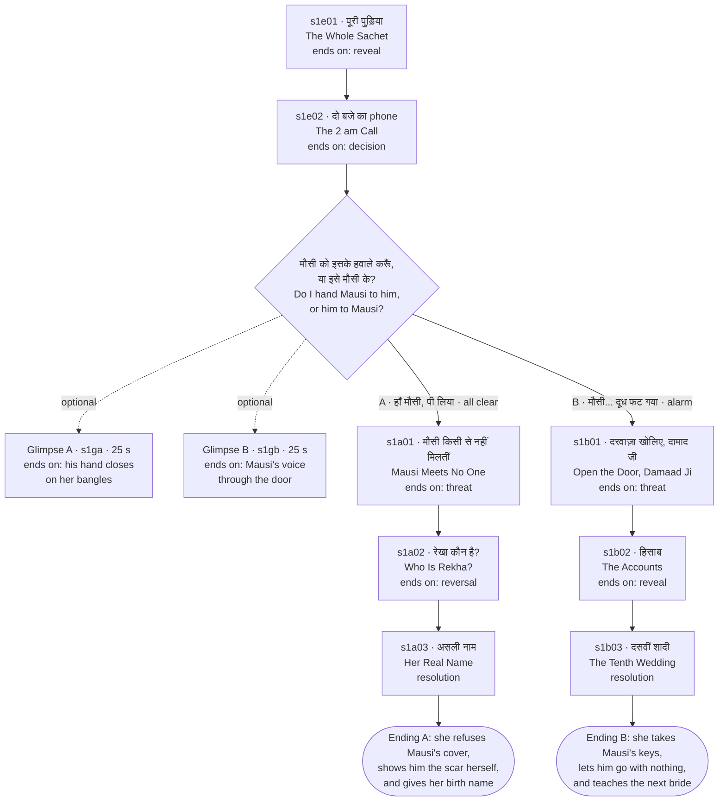

# नौवीं पहली रात · The Ninth First Night: branch map

Series 1, photoreal. Source of truth: `content/series1/bible.json`, revision 2 (after `docs/decisions.md` D-005). Five episodes on any path, eight to produce, one choice after episode 2, two glimpses. A tie goes to A.

Episode ids follow the app manifest (`s1e01`, `s1a01`, `s1b01`...). The pitch in `loglines.json` and decision D-003 call the same episodes e01, e02, a03-a05 and b03-b05.

Beat ids are stable across revisions, so D-005's beat references still resolve. Merged or cut beats leave gaps: s1e01 b7, s1e02 b8 and b11, s1a01 b4, s1a03 b9. One beat was added: s1b01 b5a.

## The ballot

s1e02 ends on Mausi's repeated question, "हाँ बेटा? पी लिया?", and Kiran's in-breath. She says no word in that episode's last beat. Each branch opens on her whole line.

| | Label (the spoken phrase) | Meaning shown under it |
|---|---|---|
| A, Hindi | हाँ मौसी, पी लिया | बिल्लू को इशारा: तीन बजे गाड़ी ले आओ। मौसी आदित्य के हवाले। |
| A, English | Yes, he drank it | Signal to Billu: bring the car at three. Mausi is handed to Aditya. |
| B, Hindi | मौसी... दूध फट गया | बिल्लू को इशारा: लड़कों को ऊपर ले आओ। आदित्य मौसी के हवाले। |
| B, English | The milk has split | Signal to Billu: bring the boys up. Aditya is handed to Mausi. |

Both meanings use one form at about one length: the signal to Billu, then who is handed to whom. `app/public/media/series1/series.json` still carries older meaning text and needs syncing from the bible.

## Shared episodes

**s1e01 · पूरी पुड़िया (The Whole Sachet).** About 1:35 am on a wedding night. Kiran, tonight called Sneha, is tapping powder into her groom's milk when he says, with his eyes shut, to pour in the whole sachet. Aditya is a pharmacist. He has padlocked the door from inside, the key is round his neck, the jewellery is brass, the house is rented by the month and her SIM is in his hand. In the lane Billu, the bride's "brother", waits in the car for a 2 am call and a 3 am pickup; on his phone Mausi calls the bride Kiran, so the viewer knows "Sneha" is false before Aditya does. Aditya spent fourteen months becoming the bureau's mark because his brother Mohit married one of its brides and killed himself eleven days after she robbed him. He was not at that wedding and has one photograph: a bride's left hand, with no henna on it, and a crescent burn scar. He wants that hand. Kiran's left forearm is kept out of frame for the whole episode until the last shot, in which she slides her chooda down over the same scar. Ends on a reveal: how long before he sees her wrist?

**s1e02 · दो बजे का phone (The 2 am Call).** Opens in the same second with his demand to see her hands. He takes the correct hand, holds it down on the sheet beside the print and starts taking the red cuff apart, sliding the bangles off over her hand one at a time. Three lie on the sheet when she lifts the drugged milk to her own mouth, and he has to let go to stop her: he needs her awake. Then she gives him a lie to chase, a scarred girl called Rekha who sits beside Mausi, and a clock: Mausi rings at two, and a dead phone brings Billu up. He tells her to her face why he is stopping (if she were that girl she would not be telling him where the girl sits), hands the three bangles back himself and sets the order: "पहले मौसी। रेखा बाद में।" She slides them on again. He puts her SIM back; he knows the call is the gang's check on the groom, and she tells him there is no code. He tells her, calmly, what he will do to the owner of that hand, and promises "Sneha" that she can walk if she takes him to Mausi. In the lane, out of his hearing, Mausi gives Billu the code: "he drank it" brings the car, "the milk has split" brings the boys, and so does anything else or silence. At two the call comes on speaker. Mausi asks if Kiran has eaten, and Aditya finds the mathri she packed in the bag. Then she asks whether the son-in-law has drunk his milk, and asks again. Kiran breathes in and has not spoken. Ends on the decision.

## Branch A: road and sting

**s1a01 · मौसी किसी से नहीं मिलतीं (Mausi Meets No One).** Opens on the whole line: "हाँ मौसी, पी लिया।" Aditya heard the answer he expected to the check he expected; Kiran tells him there was another sentence, and what it would have done. One line from her sets their cover, and the rest is played, not planned: Mausi sees no one unless he is useful, so he goes in as a thief who married a thief, with his brass and his rented house as proof. She changes into grey; he tells her to keep the chooda on because they are arriving as newly-weds. At dawn Billu drives them down the highway, saying Mausi meets no one. On Billu's phone Kiran tells Mausi why she gave the all-clear with the groom awake: if the boys had come up, the deal would have died. Mausi says to bring him. Billu catches sight of the photograph in the mirror. At the bureau's shutter Aditya takes her bangle hand to help her out, and looks up as the shutter rises on Mausi. Inside, Chhoti, nineteen, sits on the cot being readied for her first wedding, and no scarred girl sits with Mausi. Mausi accepts the pharmacist, then tells Kiran to hand over the chooda for Chhoti and starts to slide it off in front of him. Ends on a threat.

**s1a02 · रेखा कौन है? (Who Is Rekha?).** Opens on the first bangle at her knuckles. Kiran makes a fist and Aditya himself stops Mausi, playing the generous husband and paying for a new set. He is in; Billu's welcoming hug lifts the photograph from his pocket. Aditya sees where the ledger is kept and begins to doubt Rekha. In the back-room store Kiran watches Chhoti, who wants to try on the chooda and thinks it is only one night. While Mausi oils her hair, reminds her who gave her the name Kiran and promises the eighteen lakh, Kiran steals the keys from her hip. With Mausi behind the marigold curtain fitting Chhoti's blouse and Kiran standing in the gap, Aditya photographs the ledger and sends it to his police contact, who passes it to the nearest post; he tells Kiran aloud that the police will be there in half an hour. Then Billu puts the photograph on Mausi's desk. She knows the scar at once, and asks Kiran, gently, whether she should tell him whose hand it is. Ends on a reversal.

**s1a03 · असली नाम (Her Real Name).** Mausi holds the truth and chooses not to spend it. She works out that he is Mohit's brother; Kiran asks whether she knew he died, and her silence is the answer. With the shutter down Aditya asks for Rekha by name. Mausi has never heard the name, understands what her girl did, and backs the lie: Rekha ran off two years ago. She does not reach for Kiran's wrist and does not offer the hand to anyone. Kiran refuses the cover: she takes off the chooda and shows him the scar herself, and says there was never a Rekha. He takes out the half-full sachet he has carried since the wedding night. Mausi steps in front of Kiran, offers him a price and calls the girl hers; Kiran answers by holding out Mausi's own keys. She tells him the last small true things about Mohit. The police arrive as light through the shutter; Billu runs out the back and Chhoti is sent home. Aditya pours the powder away, steps back from Kiran and gives the police two names. Mausi goes out behind her own ledger, tucking Kiran's hair behind her ear on the way. At the chowki Kiran is asked her name and answers Sneha, then Kiran, then Tulsi, the name her mother gave her. Resolved: he saw the wrist and gave up his revenge; she has one name and no secret.

## Branch B: siege and coup

**s1b01 · दरवाज़ा खोलिए, दामाद जी (Open the Door, Damaad Ji).** Opens on the whole line: "मौसी... दूध फट गया।" Billu and the two boys come up, and the padlock Aditya fitted is suddenly the only thing keeping them out. Mausi, told that a groom has locked his bride in, forbids them to break the door and sets out herself. Aditya, lied to once already, comes for Kiran's hands again. She sits down with her back against the door, her left arm under the pallu, and tells him that if he touches her she will scream and the door will not last. He stops, and they wait like that for two hours. He could call the police and does not: as she tells him, all he could show them is a lock he fitted, a false name and a mother come to fetch her daughter, and after fourteen months the woman who meets no one is coming to him. At about 4:30 am a hired car's headlights cross the ceiling, Kiran moves clear of the door, the hasp is torn out and Mausi asks him, warmly, to open the door. She checks that Kiran is unhurt, reads his notebook, recognises the scar in the photograph and says nothing about whose it is. It comes out, in her own words, that she knew Mohit died. Then she decides: this man cannot be frightened or robbed, and nobody will ask about a second brother dead of shame. She puts two sachets in Kiran's palm. Ends on a threat.

**s1b02 · हिसाब (The Accounts).** Kiran stalls: the old milk will not do, a fresh glass must be warmed. On the stairs she asks Billu who will carry the body, whose name the car is in, and what he was told the last wedding brought. Upstairs Mausi and Aditya talk like two shopkeepers. Kiran returns, appears to pour both sachets, whispers something to Aditya that we do not hear, and he drinks and slumps. Mausi praises her. Chhoti rings, a young voice asking if she may sleep. Kiran asks for her account now that the last wedding is done, and learns there was never a last wedding and never eighteen lakh: daughters do not get accounts, and after tonight where would she go? Billu has overheard the money. Behind her back Kiran's fist opens on two unopened sachets, and on the bed one of Aditya's eyes opens a slit behind his glasses and shuts. Ends on a reveal: he is alive and only she knows.

**s1b03 · दसवीं शादी (The Tenth Wedding).** As Billu moves to shut the dead man in, Kiran does the accounts aloud: every wedding, what came and what he was told, and whose name tonight's body would have carried. She shows the unopened sachets and Aditya sits up. Mausi's last weapon is the truth: she pushes up the chooda and shows Aditya the scar, to turn him on Kiran. He sees the hand at last and can do nothing with it; it is the hand that refused to kill him. Kiran takes the keys from Mausi's hip, tells her "हिसाब अब मैं रखूँगी, मौसी।", and gives Mausi the life she invented for Rekha, writing the accounts. At dawn she lets Aditya go without his photograph, his notebook or his proof. That evening at the bureau, bare-armed, the keys at her waist, she steadies Chhoti's shaking hand over a glass of milk and repeats the first line of the series. Resolved: she kept everything and became the new Mausi.

## The wrist, path by path

- **Shared.** s1e02 b1 to b4: he asks for her hands, takes the correct one and has three bangles off when she lifts the glass. He stops by his own decision and says why to her face.
- **Branch A.** Six near misses, each with a shown reason: he orders the chooda kept on (s1a01 b5); the shutter rises on Mausi as his fingers close on it (s1a01 b9); Mausi starts to strip it for Chhoti (s1a01 b11) and he stops her himself (s1a02 b1); Chhoti reaches for it while he is in the other room (s1a02 b4); Mausi, holding the print, is about to say whose hand it is (s1a02 b9). He sees the scar when Kiran chooses to show it (s1a03 b3).
- **Branch B.** He comes for her hands again and she blocks him with the door at her back (s1b01 b5a). After the door opens the boys hold him on the chair (s1b01 b9), Mausi recognises the scar and keeps quiet because she needs that hand to pour (s1b01 b10), and from s1b02 b5 he lies still with his eyes shut. He sees the scar when Mausi exposes it (s1b03 b4).

## Kept apart in the two finales

Day-1 viewers can watch both endings back to back, so the two finales are kept apart on these four points.

| | s1a03 | s1b03 |
|---|---|---|
| Mausi and the scar | Knows whose hand it is, covers for Kiran, never reaches for the wrist | Catches the wrist and pushes the chooda up herself |
| Who reveals it | Kiran, by choice, refusing the cover | Mausi, as a weapon |
| Kiran's line to Mausi | "हाँ मौसी। आपने ही सिखाया है।" | "हिसाब अब मैं रखूँगी, मौसी।" |
| That Mausi knew Mohit died | Kiran's question, Mausi's silence (s1a03 b1) | Said by Mausi, "the boy turned out weak" (s1b01 b10) |

## Glimpses

- **Glimpse A (s1ga, from s1a01, 25 s).** Her voice giving the all-clear; the key opening the padlock; the dawn car and Billu's line that Mausi meets no one; the shutter. Ends as Aditya takes her bangle hand. Does not show the shutter opening, Mausi's face, or anything after.
- **Glimpse B (s1gb, from s1b01, 25 s).** Her voice giving the alarm; Billu's toothpick, boots on the stairs, "what did you say to her?"; headlights on the ceiling. Ends on the torn hasp and Mausi's voice through the door. Uses nothing from the two-hour wait, and Kiran is clear of the door in its last frames. Does not show Mausi's face, the sachets, or anything after.

## Branch test

Written without naming the choice. A: two people walk into a marriage bureau by daylight posing as partners, steal its ledger, and are undone by a photograph; the woman who runs it tries to shield her girl, the girl confesses instead, and it ends in a police post. B: a man is besieged overnight in a locked bedroom, a matriarch orders his death, and her apprentice fakes it and takes her place; it ends with a new bride being trained. Different places, different antagonists in the room, different endings for all five principals.

## Length

Beats per episode after D-005: s1e01 10, s1e02 11, s1a01 10, s1a02 9, s1a03 10, s1b01 12, s1b02 9, s1b03 10 (81 in all, down from 85). The target is about 120 spoken seconds an episode with a ceiling of about 135. These are estimates from beat and line counts; no script exists and nothing was timed. s1e02 b5 is protected from trims because it carries two of the five balance levers.

## Not verified

- `bible.json` has still not been run through a JSON parser. The showrunner has no shell; only pattern searches were run.
- The Script critic has not yet re-read the changed beats.
- No frame was viewed: bangles coming off over a hand, the boys as silhouettes, and an eye opening behind glasses are untested as stills.
