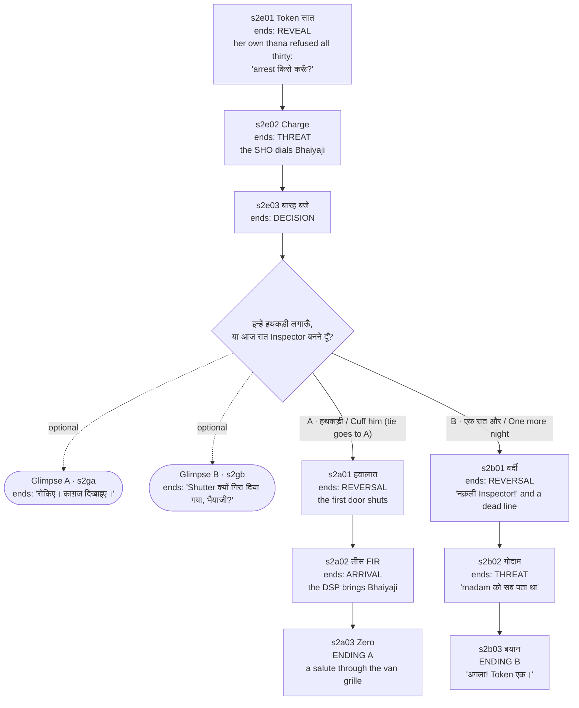

# Duplicate थाना (The Duplicate Thana): branch map

Series 2 · flat 2D · small-town cop caper · 6 episodes on any path, 9 to produce, 2 glimpses.
Source of truth: `content/series2/bible.json`. Decisions: D-004 (logline) and D-006 (Gate 1b) in `docs/decisions.md`.
Regenerated from the bible after D-006 changes 1 to 23. D-006 amends two D-004 locks: Glimpse A is recut from the first half of s2a01, and the question now says "इन्हें".

Ids used here and in the app are on the left; the loglines file and D-004 number by path position (right).

| This file | Loglines / D-004 | Title |
|---|---|---|
| s2e01 | e01 | Token सात (Token Seven) |
| s2e02 | e02 | Charge (Handing Over) |
| s2e03 | e03 | बारह बजे (Midnight) |
| s2a01 | a04 | हवालात (Lockup) |
| s2a02 | a05 | तीस FIR (Thirty FIRs) |
| s2a03 | a06 | Zero |
| s2b01 | b04 | वर्दी (Uniform) |
| s2b02 | b05 | गोदाम (Godown) |
| s2b03 | b06 | बयान (Statement) |
| s2ga, s2gb | glimpse A, glimpse B | cut from s2a01 and s2b01 |

Beat ids are stable across the revision. s2e02 has no b9: it was merged into b8.

## One night, one set of facts

Fixed before the choice and true in both branches. Nandini and the viewer learn it only after the vote.

- About 7 p.m.: Tripathi phones Bhaiyaji and tells him the Inspector is a fake.
- The same evening, off screen: Tripathi signs and stamps the truck's movement slip himself.
- By midnight the truck is fully loaded. The invitation is not for a stamp. It is for Nirala.

Branch A reads the signature at the crossing (s2a01 b6) and infers the rest from the slip (b8). Branch B hears Nirala read the same signature aloud on the open call (s2b01 b9), and it is item three of the seizure memo (s2b02 b7).

## The choice

Asked by Nandini at the end of s2e03, 11 p.m., over Nirala's outstretched wrists: "इन्हें हथकड़ी लगाऊँ, या आज रात Inspector बनने दूँ?" (English unchanged: "Do I cuff him, or let him be Inspector tonight?")

- **A, हथकड़ी (Cuff him).** Gain: Nirala is alive and in her lockup tonight, by the book. Cost, spoken before the vote (s2e03 b7): the SHO will stamp the slip in his place, and she cannot stop a truck that carries her own SHO's stamp. She locks up the one policeman Imlipur trusted and watches eight hundred sacks leave town knowing she let them; the one door into the godown shuts.
- **B, एक रात और (One more night).** Gain: the only chance there will ever be to catch Bhaiyaji with the grain. Cost, spoken before the vote and never taken back (s2e03 b6): the DSP has ordered Nirala locked up now and said that any officer who helps him will be named in the same FIR. And she sends a frightened, unarmed man to a strongman her own SHO phoned that evening.

The transfer application is not part of the choice and is not mentioned in s2e03, on the ballot or in either glimpse. Balance dial 3 is now used (it is the DSP's line in s2e03 b6). Dials 1 and 2 are not used.

## Shared episodes

**s2e01 Token सात (Token Seven).** Opens on a khaki sleeve holding cardboard token seven in a police station that turns out to be the lobby of a shut cinema, with a ticket booth for a lockup. Sub-Inspector Nandini Joshi, six weeks into her first posting, tells the small man in the too-big uniform and peaked cap that this thana is not in her records; he pours her tea. At her own thana the SHO, Tripathi, shrugs under his zero-crime shield (two years without an FIR), and Head Constable Pushpa mentions Nandini's own pending transfer application. Nandini rings the DSP herself on the desk phone; the order is to have the man in her lockup before ten tomorrow, when the DSP holds a press conference at this thana. She goes back with Pushpa, seizes the registers and opens the thickest file: thirty complaints against the strongman Bhaiyaji. She reads one aloud: a date, and that her own SHO refused it. All thirty were turned away by her own thana. Her hand stops on the cuff pouch: "तो कल दस बजे से पहले... arrest किसे करूँ?" Ends on a reveal.

**s2e02 Charge (Handing Over).** Opens in the same room seconds later, her handcuffs out. Nirala does not run; he asks to hand over charge first. In a four-line exchange Pushpa gives the set-up: she sent everyone Tripathi refused across the railway line, and Tripathi has known for two years but said nothing to the department or to Bhaiyaji, because speaking would cost him the shield. Nandini watches Nirala settle a bicycle dispute in ten minutes, saying every word aloud as he writes it. Bhaiyaji arrives in person; she hides in the ticket-booth lockup, helmet and all, and watches him hand "Inspector साहब" the month's envelope: the payment is shown before anyone describes it. Nirala seals it, with note numbers, as case property, and enters it in the ledger: the twenty-fourth. He tells her he failed the entrance nine times by one centimetre of chest. She gives him until morning. That evening Tripathi learns she is reading the files and dials Bhaiyaji: "एक बात बतानी थी... वो talkies वाली चौकी के बारे में।" Cut. Ends on a threat.

**s2e03 बारह बजे (Midnight).** Opens on Nirala's phone buzzing at half past ten. On speaker, Bhaiyaji asks his Inspector to the godown at midnight, alone, to stamp the movement slip for eight hundred sacks of ration grain: the crossing is the outpost's, the outpost is cheaper than Tripathi, and it is the same as every month. Pushpa arrives with what she overheard: Tripathi's call connected, she heard "talkies", and nobody knows what Bhaiyaji said back. Nandini rings the DSP and tells him the truth: Bhaiyaji's own voice, on Nirala's phone. He will not raid on something heard on a fake thana's phone, orders Nirala locked up now, and says any officer who helps him will be named in the same FIR. She says both roads aloud: arrest him and he is safe, but the SHO will stamp the slip and she cannot stop a stamped truck; send him and it is on her word, against the order. Nirala lays his revolver on the desk, and it is carved teak; in two years it has never left its holster; his hands shake. He holds out his wrists and leaves it to her. Nandini asks the question. Ends on the decision.

## Branch A: हथकड़ी

**s2a01 हवालात (Lockup).** Opens on the handcuffs closing: "आप under arrest हैं।" Nirala asks only to keep his cap, helps book his own wooden revolver, and becomes the first prisoner in the real lockup in two years. At midnight he says where he should be. At the crossing Nandini steps into the truck's headlights: "रोकिए। काग़ज़ दिखाइए।" The slip is signed and stamped by her own SHO. "काग़ज़ पूरे हैं।" She watches the tail-lights cross the line at ten past twelve. Back at the bars, Nirala works it out from the slip: if the SHO's stamp was already on it, his was never needed, so the invitation was for him. Then he tells her what is left: at ten there will be microphones in this thana, and a register laid in front of them cannot be buried. Pushpa produces a second key to the SHO's almirah on a loop of wool, and the FIR register comes out blank. At one a.m. the first complainant looks at her uniform and shuts the door: "असली थाने में एक बार जा चुके हैं, madam।" Ends on a reversal.

**s2a02 तीस FIR (Thirty FIRs).** Opens on the lockup key. She cuffs his right wrist to her own left and takes him out, the red file under his free arm: he is the only one the doors will open for. His habit of saluting drags her arm up with his. At each door the fake inspector vouches for the real one by confessing; the register is written on a desk made of their two chained forearms; he corrects her drafting; an old woman scolds her for chaining a man who found her goat; he has to tell a young man not to trust the stamp he made himself. Then one door will not open for him either: "जो ख़ुद हथकड़ी में है, वो हमें क्या बचाएगा, निराला जी?" Nandini wins it herself: "हथकड़ी मेरी है। और कल रात आपका अनाज मेरे सामने से गया। FIR लिखवाइए, ताकि दोबारा ना जाए।" Thumbprints fill the pages; at half past nine it is twenty-seven; by ten to ten she says "तीस" and salutes with him by choice. They reach the thana as the DSP's car pulls up, with Bhaiyaji, garlanded, as chief guest. Ends on an arrival.

**s2a03 Zero.** Opens mid-speech at a table of microphones. Nandini hands over the impersonator in cuffs, as ordered, then puts the register among the microphones and reads FIR number one, naming बलराम ठाकुर, उर्फ़ भैयाजी, before the DSP can cover them. One reporter, off screen: "DSP साहब, chief guest ही आरोपी हैं?" All thirty record that Tripathi refused them, and the truck left on his signature. The DSP, in front of the press, takes the credit and has Bhaiyaji and Tripathi taken into custody. Pushpa lays the zero-crime shield face down. The grain is gone for good and Nandini says so. She takes her transfer application back. The same morning, straight after the press conference, Nirala, still in his uniform and cap, tells her through the grille of the prison van that he will plead guilty; she sets his cap level and returns his salute. Behind her the thana bench is full for the first time, with last night's complainants. Resolution.

## Branch B: एक रात और

**s2b01 वर्दी (Uniform).** Opens on her hand pushing his wrists down. Pushpa starts to object; Nandini has heard the order and knows whose name will be written. She dresses him as an officer of her own force, unpins the home-made medal ("लौटकर ले लीजिएगा"), buttons the wooden revolver into its holster and puts her own phone in his pocket on an open call to Pushpa's handset, where the recording is made and kept ("Recording चालू है, madam।"). He walks alone into the dark mouth of the godown and the shutter comes down behind him. A second later, in full voice, to Bhaiyaji: "Shutter क्यों गिरा दिया गया, भैयाजी?" From the tea stall she hears him do the job, and Bhaiyaji confirm eight hundred sacks in his own voice. Then Nirala reads the slip aloud: it already carries the SHO's signature. Bhaiyaji laughs: "नक़ली Inspector! आइए... आप ही का तो इंतज़ार था।" Nandini: "इन्हें पता था।" He finds the phone. The line goes dead. Ends on a reversal.

**s2b02 गोदाम (Godown).** Opens on the dead tone; she goes in with only Pushpa. Inside, the truck stands fully loaded, and Bhaiyaji has a confession ready for Nirala to sign as leader of a "fake police gang" that looted the grain, with Tripathi on his way to make the arrest the DSP wants. Nirala, shaking, corrects its date and will not sign. Nandini bangs on the shutter. Bhaiyaji offers her the easy way out: take the impostor, as ordered. At twenty past twelve she takes out a memo pad and writes the seizure aloud, item by item, with Pushpa as witness and Nirala supplying the count; item three is the movement slip with Tripathi's signature; Pushpa pockets the truck key. Tripathi arrives at half past twelve and becomes item six. Nandini rings the DSP: it is no longer something heard on a fake thana's phone, and he sends a force. Cornered, Bhaiyaji tells Tripathi whose phone was in the impostor's pocket, and Tripathi points at her: "तो इसे अंदर madam ने भेजा। Court में मैं यही बोलूँगा: madam को सब पता था।" Ends on a threat.

**s2b03 बयान (Statement).** Opens inside the defence lawyer's question at the bail hearing: did she know the man was not police? If she says no, Nirala falls alone and she is safe. Nirala tries to take it all on himself. She stops him and says she knew, she sent him, the phone was hers and the decision was hers. Then she says why that decides the case: a phone in an impostor's pocket is not evidence, a phone an SI sent in is, so the recording is hers, and on it Bhaiyaji greets the fake inspector he was waiting for. Bhaiyaji and Tripathi are charged and refused bail. On her own statement she is suspended and will stand trial alongside Nirala, who gets bail; Pushpa takes her epaulettes and the thana. Weeks later, the old talkies has a new board. Nandini, in a plain kurta, sits at the desk with the medal as a paperweight. Nirala, bare-headed: "मेरी तारीख़ अगले महीने है। आपकी?" "उसी दिन। बुलाइए।" "अगला! Token एक।" Resolution.

## Glimpses

**Glimpse A (s2ga, about 25 s, from the first half of s2a01: b1, b4, b5 and the first line of b6).** The cuffs closing, "बस... cap रहने दीजिए।"; the lockup door closing on a man in full uniform; "बारह। भैयाजी इंतज़ार कर रहे होंगे।"; she steps into the truck's headlights with her hand up, "रोकिए। काग़ज़ दिखाइए।" It ends there. Must not show: whether the truck passes, who signed the slip, "काग़ज़ पूरे हैं", "मैंने जाने दिया", "FIR लिखिए", the shut door, the inference that Bhaiyaji knew, anyone signing, the cuffed walk, the second key.

**Glimpse B (s2gb, about 25 s, from s2b01: b3, b4, b6, b8).** Her fingers unpinning the medal; the wooden revolver going into its holster; a small figure walking alone to the godown; the shutter coming down, and a second later, in full voice, to Bhaiyaji: "Shutter क्यों गिरा दिया गया, भैयाजी?" Must not show Bhaiyaji's answer, his laugh, "इन्हें पता था", the dead line, the slip being read, or anything else inside the godown.

Neither glimpse shows its branch's loss as done.

## Checks against the brief

- Path length: 3 shared + 3 = 6 on either path; 9 episodes; 2 glimpses.
- Cliffhanger types by path. A: reveal, threat, decision, reversal, arrival, resolution. B: reveal, threat, decision, reversal, threat, resolution. No type repeats back to back.
- Every non-final ending is a spoken line; no ending depends on reading an overlay. Both glimpses end on a spoken line.
- Seven location plates, six character sheets, three one-shot faces, no crowd. Voices without faces: the magistrate, the defence lawyer, one door in s2a02 (b10) and one reporter in s2a03 (b4).

## Not verified

- `bible.json` has never been run through a JSON parser. It was checked by pattern searches only.
- Length: the budget is key lines at or under about 950 characters an episode (s2e03 about 1,050). It is provisional; no speech rate has been measured. The showrunner's per-episode figures are estimates by eye and several sit on the line. They must be counted by a tool.
- The vote split and the effect of the D-006 changes on it are judgements.
- The default wordings from D-006 are untested until the critic reads them in place.
- `content/series2/loglines.json` was changed in one place only (the antagonist's name). It is the Gate 1a artefact and still carries the earlier pitch (the old question pronoun, "fourteen months", the old A ending).
- `app/public/media/series2/series.json` still carries the old question text; the product track syncs it from the bible.
