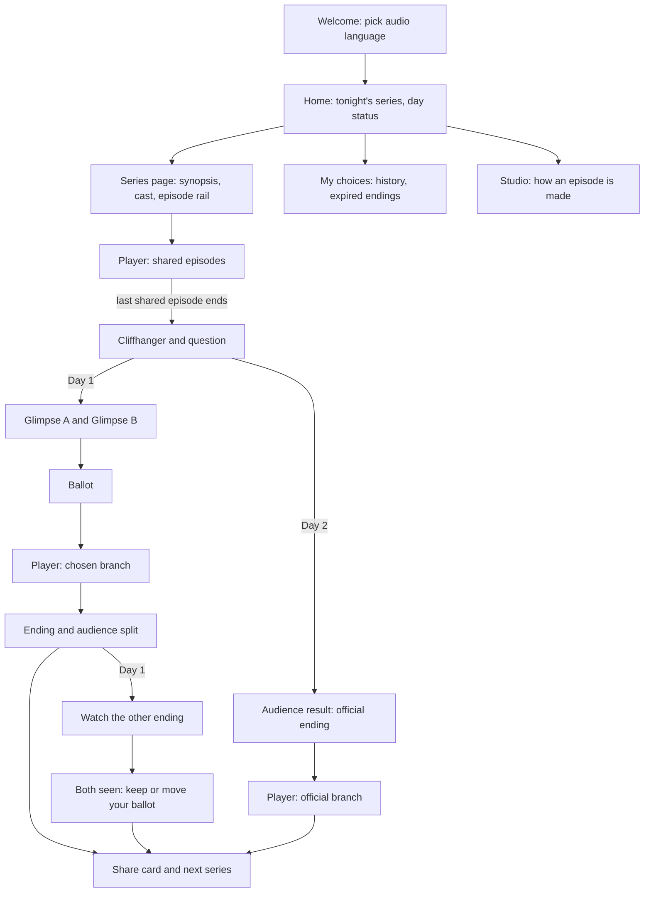
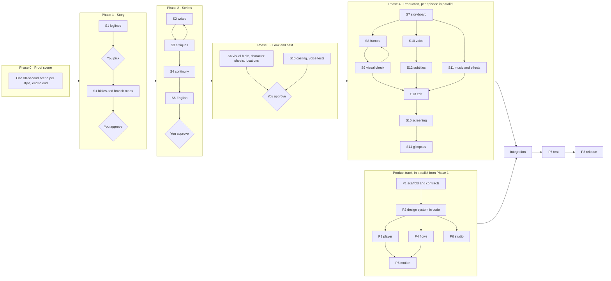

# Unwritten — product POC plan

Status: draft for approval · 25 November 2026
Design direction: C, Spatial Stage · [mockups](https://claude.ai/artifact/NaeZmVec8UGxNpP2Trhoqj) · [design system](https://claude.ai/artifact/9Yw2dAgQzsGQmFHHEEheT9)

## 1. What we are building

A finished, end-to-end demo of the Unwritten viewer product, so the team can see exactly what the product is and how an episode comes out. It is not production software: votes are simulated, there are no accounts, and new stories cannot be created inside it. Everything a viewer would do in the real product can be done in the demo, with two fully produced series.

**Goals**

- A viewer can open the app on a phone or desktop, watch a series, see a glimpse of each choice, vote, finish their branch, watch the other branch, change their vote, and come back on "day 2" to find only the winning branch.
- Two complete series: one photoreal, one 2D illustration. Each has 4–7 episodes of about two minutes, voiced by a full cast in Hinglish and in English, with music, sound effects and subtitles.
- A Studio section that walks through how an episode is made, agent by agent, using the real scripts, frames and voice takes from the two series.
- State-of-the-art look and sound. No budget cap, but no waste.

**Not in this POC**

- Real voting, sign-in, payments, Story Coins or creator tools that generate new stories.
- More than two series. More than one choice point per series (see open question 1).
- Native apps. It is a responsive web app.

**It has failed if** the stories are not gripping, the Hindi sounds robotic, characters change face between shots, or the day-one rule is not obvious to someone using it for the first time.

## 2. Product rules

These come from your answers. Anything marked *assumed* is my call and is listed again under open questions.

| Rule | Behaviour |
|---|---|
| Launch day | A series launches with all its episodes. Day 1 lasts 24 hours from launch. In the POC the day is switched by hand: a control moves the app from day 1 to day 2, and a reset button clears all watch history. |
| Shared episodes | Everyone watches the same opening episodes (two or three, depending on the story). The last shared episode ends on a cliffhanger and the question. |
| Glimpses | Before voting, the viewer watches a short glimpse (about 20–30 seconds) of each choice. Each glimpse ends on its own new cliffhanger and never reveals the outcome. Glimpses are optional: the viewer can vote without watching them. |
| The choice | One ballot per viewer. The viewer then watches their chosen branch to its ending. |
| The other ending | Only after finishing their own branch, and only on day 1, the viewer can watch the other branch. |
| Changing the vote | A day-1 viewer who has finished both branches can move their ballot once *(assumed: once)*. |
| Day 2 onwards | Only the more popular branch remains for new viewers: the official ending. A viewer who watched the other branch on day 1 keeps access to what they watched. |
| Late viewers | Someone who first arrives on day 2 watches the shared episodes, sees the question, can watch both glimpses to see what they missed, sees how the audience voted, and continues on the official branch. No ballot. |
| Votes | Simulated. Tallies start from seeded numbers and include the viewer's own ballot. A tie goes to choice A. |
| Languages | Audio in Hinglish (default) or English, switchable at any time. Subtitles follow the audio language and can be turned off. |

**Subtitle and script convention.** Hindi words are written in Devanagari and English words in Latin script in the same line ("यह file किसने खोली?"). That exact text is what ElevenLabs reads, so what is heard is what is shown. English mode is a full adaptation performed by the same cast.

## 3. Content scope

| | Series 1 | Series 2 |
|---|---|---|
| Look | Photoreal, cinematic, fictional Indian cast | Flat 2D digital illustration, bold outlines, in the style of your reference image |
| Length | 5 episodes on any one path *(proposed)* | 6 episodes on any one path *(proposed)* |
| Choice point | After episode 2 | After episode 3 |
| Episodes to produce | 2 shared + 3 × 2 branches = 8 | 3 shared + 3 × 2 branches = 9 |
| Glimpses | 2 | 2 |

Totals: 17 episodes (about 34 minutes) and 4 glimpses, each in two languages. At the 3–5 seconds a shot that vertical dramas typically run, that is about 25–30 frames an episode, so roughly 450–500 story frames plus character sheets and location plates, and about 70 minutes of finished voice.

Both stories are new. I will not reuse the three from the concept note. Series 1 is a crime or con story; Series 2 is a small-town cop caper in the spirit of your reference image. You set no content limits: the stories go where they need to. The Showrunner proposes three loglines for each series; the Script critic and the Arbiter (section 5) pick the strongest, with the reasoning recorded.

One practical limit remains that is not a creative choice: image models refuse some content (for example realistic gore, or real insignia). Where a shot is refused the frame artist restages it rather than dropping the story beat.

Story craft rules the writers and the critic work to:

- Every episode opens inside a moment (no recap narration) and ends on an unanswered question.
- The choice must cost the lead something either way. If one option is obviously right, the script goes back.
- Each branch is a different story, not the same events with a different line. By its last episode each branch reaches a real ending.
- Dialogue is how people actually speak in Hinglish: short lines, interruptions, English nouns and verbs inside Hindi sentences.
- No narrator unless the story needs one. Sound and picture carry the scene.

## 4. Viewer flow and screens



| Screen | What it does |
|---|---|
| Welcome | One-time: choose हिंदी or English audio; one line explaining the day-one rule. |
| Home | The stage shows tonight's series with a day status chip and countdown. A dock switches series. A "coming next" shelf shows future series as teasers only *(assumed)*. |
| Series page | Synopsis, cast with voice samples, episode rail showing the branch point and locked episodes. |
| Player | Vertical 9:16 stage. Tap to pause, swipe or tap edges for previous/next shot, progress segments, language switch, subtitles toggle, auto-advance to the next episode. The room behind the stage takes its colour from the current shot. |
| Question | The stage holds on the cliffhanger frame and the question appears in the character's words. |
| Glimpses | Two cards side by side; each plays in the stage. Watched state is tracked. |
| Ballot | Two options, countdown to the end of day 1, cast button. After casting, the audience split appears. |
| Ending | Final frame, audience split, and on day 1 the offer to watch the other ending. |
| Keep or move | After both endings: keep or move the ballot, with the live split. |
| Day-2 result | "The audience chose …" with the split, then straight into the official branch. |
| My choices | Per series: what you chose, what won, what expired, resume points. |
| Share card | A 9:16 image with the question and the viewer's choice, without spoilers, downloadable. |
| Studio | The process flow in section 6, stage by stage, with the real artefacts for one episode: bible page, script with emotion cues, storyboard frames, voice takes you can play, the mix, the final cut. Read-only. |
| Demo controls | A hidden drawer for presenters: switch day 1 / day 2, set which ending wins, reset progress, jump to any screen *(assumed)*. |

Phone layout is the primary design; desktop places the stage in the centre with glass panels either side, as in the direction C mockups.

## 5. The agent team

Two tracks run side by side: a **content studio** that makes the two series, and a **product team** that builds the app. I act as producer: I brief each agent, check what comes back against the acceptance checks below, and bring the gates to you.

### Arbiter (decision specialist)

You asked for the build to run end to end without stopping for approvals, with a specialist agent settling any question logically and through research. That agent is the Arbiter.

| # | Agent | Owns | Hands on |
|---|---|---|---|
| A0 | Arbiter | Every decision that would otherwise come to you: story choice, script sign-off, cast and look approval, trade-offs between quality, time and credits, and any ambiguity in the product rules. It gets the options and evidence from the agent asking, researches where facts are missing, reasons to a decision, and never rules on its own work. | An entry in `docs/decisions.md`: the question, options considered, evidence, decision, and what would change it |

The Arbiter does not decide three things, which still come to you: spending outside ElevenLabs credits and your ChatGPT plan, anything published or shared outside this Mac, and deleting work.

### Content studio (these are also the roles shown in the Studio screen)

| # | Agent | Owns | Hands on |
|---|---|---|---|
| S1 | Showrunner | Loglines, series bible, character biographies, branch map, cliffhanger plan | `bible.json` |
| S2 | Episode writer | Hinglish scripts with stage directions and per-line emotion cues | `script.hi.json` |
| S3 | Script critic | Adversarial read: hook in first 5 seconds, stakes, both choices costly, cliffhanger strength, natural Hinglish. Scores each episode; below threshold goes back to S2 (two rounds maximum) | review + pass/fail |
| S4 | Continuity keeper | Ledger of who knows what, props, wardrobe, time of day, per branch. Checks every script and shot list against it | `continuity.json` |
| S5 | English adapter | Performable English version of every line, same beats and timing intent | `script.en.json` |
| S6 | Art director | Visual bible per series: palette, lens and light rules, character sheets, location plates | `style.json`, reference images |
| S7 | Storyboard artist | Shot list per episode: framing, action, camera move, duration, which references to use | `shots.json` |
| S8 | Frame artist | Generates every frame from the shot list with the references | `frames/` |
| S9 | Visual checker | Looks at every frame: face and costume match, hands, text artefacts, 9:16 safe areas, subtitle clearance. Rejects with a reason; S8 regenerates | frame approvals |
| S10 | Casting and voice director | Chooses a voice per character, directs each line with emotion tags, records retakes, checks pronunciation of code-mixed lines | `voice/` takes + word timings |
| S11 | Sound designer and composer | Theme and cues per series, sound effects per shot, dialogue-first mix and loudness | `music/`, `sfx/`, mix settings |
| S12 | Subtitle editor | Word timings to subtitle lines in both languages, line breaks, reading speed | `subs.hi.json`, `subs.en.json` |
| S13 | Editor | Builds the timeline: frames, camera moves, voice, music, effects, subtitles; renders each episode and glimpse | `timeline.json`, renders |
| S14 | Glimpse cutter | Cuts the two glimpses per series from branch material so each ends on a new question and gives nothing away | glimpse timelines |
| S15 | Screening reviewer | Watches each finished episode against the script: sync, pacing, audio levels, subtitle accuracy, continuity. Files fixes to the owning agent | sign-off |

### Product team

| # | Agent | Owns |
|---|---|---|
| P1 | Tech lead | Repository, app structure, content manifest format, day-and-vote state model, contracts between content and app |
| P2 | Design-system engineer | Tokens and components from the design system into the app; fonts; light and dark themes |
| P3 | Player engineer | The stage: playback, subtitles, language switch, preloading, shot-driven ambient backdrop |
| P4 | Flow engineer | Welcome, home, series page, question, glimpses, ballot, endings, keep-or-move, day-2 result, my choices, share card, demo controls |
| P5 | Motion engineer | Scroll and pointer motion, panel tilt, transitions, reduced-motion fallbacks, performance budget |
| P6 | Studio engineer | The Studio walkthrough fed by real production artefacts |
| P7 | Test engineer | Scripted walk-throughs of every path on phone and desktop sizes, accessibility and performance checks, screenshots for review |
| P8 | Release engineer | Private deployment, access protection, asset hosting |

### Skills

Each skill is a written playbook the agents load, so every episode is made the same way.

| Skill | Used by | Encodes |
|---|---|---|
| `story-bible` | S1 | Bible template, branch-map rules, cliffhanger ladder |
| `hinglish-screenwriting` | S2, S5 | Script format, Devanagari + Latin convention, line length for two-minute pacing, emotion-cue vocabulary |
| `script-critique` | S3 | Scoring rubric and rejection reasons |
| `continuity-ledger` | S4 | Ledger format and the checks to run per script and per shot list |
| `visual-bible` | S6 | Style block per series, character-sheet and location-plate recipes |
| `shot-design` | S7 | Shot grammar for vertical drama, shot length, camera-move vocabulary, subtitle-safe framing |
| `frame-generation` | S8 | Exact generation commands, reference handling, naming, retries, resumable batches |
| `frame-review` | S9 | Visual acceptance checklist |
| `voice-direction` | S10 | Voice selection, emotion tags, per-line generation, retake rules, timing capture |
| `sound-design` | S11 | Cue sheet format, music and effects generation, mix and loudness targets |
| `subtitle-timing` | S12 | Segmentation and reading-speed rules for both scripts |
| `episode-assembly` | S13, S14 | Timeline format, camera-move presets, render settings |
| `screening-review` | S15 | Episode sign-off checklist |
| `spatial-stage-ui` | P2–P6 | How to use the design system in code |
| `flow-testing` | P7 | The paths to walk and what counts as a pass |

### Model and effort per agent

Checked on 26 November against the Claude Code documentation and the workflow reference. Four models are available: Fable 5.2 (the most capable), Opus 5.5, Sonnet 5.5 and Haiku 5.5. The build session itself runs on Opus 5.5 as orchestrator, so an agent with no model set would run on Opus; every agent is therefore pinned explicitly to the model in the table below. Each agent can be pinned to a model and a reasoning-effort level (low, medium, high, xhigh, max).

The rule: anything whose judgement, writing or code shows in the finished product runs on Fable. Well-specified engineering and bookkeeping runs on Opus. Pure executors, which follow an exact instruction many hundreds of times, run on Sonnet, where speed matters more than depth. Nothing that affects quality runs on Haiku. To make that split clean, directing and executing are separate agents: the Storyboard artist writes the final image prompt and a runner only executes it; the Voice director writes the performed line and a runner only generates it.

| Agent | Model | Effort | Why |
|---|---|---|---|
| A0 Arbiter | Fable | xhigh | Makes the calls you would have made; must reason from evidence and research |
| Debugger (section 7.8) | Fable | xhigh | Root-cause work on unfamiliar failures |
| S1 Showrunner | Fable | xhigh | Story architecture, branch design, cliffhangers |
| S2 Episode writer | Fable | high | Natural Hinglish dialogue is the hardest writing in the project |
| S3 Script critic | Fable | xhigh | The toughest judge; a weak critic lets a weak story through |
| S4 Continuity keeper | Opus | high | Careful ledger tracking against a fixed format |
| S5 English adapter | Fable | high | Performable adaptation, not translation |
| S6 Art director | Fable | high | Sets the look; errors in a reference sheet are copied into every frame |
| S7 Storyboard artist | Fable | high | Shot design and the exact image prompt for every frame |
| S8 Frame runner | Sonnet | low | Runs the prompt, handles retries, names and files the result; no creative decisions |
| S9 Visual checker | Fable | high | Judging faces, costumes and artefacts from the image itself |
| S10 Voice director | Fable | high | Casting and the emotion direction for each line |
| Voice runner | Sonnet | low | Generates and downloads each take exactly as directed |
| S11 Sound designer | Opus | medium | Cue sheets and prompts for music and effects |
| S12 Subtitle editor | Sonnet | medium | Rule-based line breaking and timing in both scripts |
| S13 Editor | Opus | high | Timelines and camera moves in Remotion |
| S14 Glimpse cutter | Fable | high | Editorial judgement about what a glimpse may reveal |
| S15 Screening reviewer | Fable | high | Final quality judge on every episode |
| P1 Tech lead | Fable | xhigh | Architecture and the contracts everything else depends on |
| P2 Design-system engineer | Opus | medium | Porting a finished system into code |
| P3 Player engineer | Fable | high | The centrepiece of the product; playback edge cases on phones |
| P4 Flow engineer | Fable | high | Day, ballot and history logic must be exactly right |
| P5 Motion engineer | Opus | high | Animation craft against a written motion spec |
| P6 Studio engineer | Opus | medium | A read-only walkthrough from existing artefacts |
| P7 Test engineer | Opus | high | Scripted walk-throughs; an independent Fable reviewer checks the code itself |
| P8 Release engineer | Sonnet | low | Local run instructions only, for now |

Two adjustments happen automatically:

- **Promotion on failure.** If a role's output fails review twice, it is rerun one tier up (Sonnet to Opus, Opus to Fable) or at higher effort, before the failure ladder in section 7.8 reaches a placeholder.
- **Second opinions.** Where a gate decision is close, the Arbiter asks for a second judge on a different model (Opus alongside Fable), because two different models miss different things.

### How the harness is used

- **The main session only orchestrates.** It briefs agents, reads their structured results and decides what runs next. It does not write scripts, frames or app code itself, so its context stays clear for a build that runs for many hours.
- **Every agent is defined once** in `.claude/agents/<name>.md` with its model, effort, the tools it may use and the skills it preloads. Checkers get read-only tools. Runners cannot spawn other agents. Workflows call agents by type and do not pass a model, so the definition is the single source of truth.
- **One workflow per phase,** not one giant script. Each returns structured results that are read before the next phase starts. Episode production is a pipeline: each episode moves through storyboard, frames, voice, sound, edit and screening on its own, without waiting for the others.
- **Interrupted runs resume.** A workflow restarted from its run id reuses every agent result that already finished, so a crash or restart does not pay for the same work twice.
- **Concurrency is limited by the outside services, not the harness.** The harness runs up to about 16 agents at once. ElevenLabs and Codex will tolerate fewer; the proof scene measures how many frame and voice lanes can run together, and episodes are released in groups of that size.
- **Scripts, not agents, for mechanical work.** Upscaling, loudness, rendering, downloads and manifest checks are plain scripts: faster, free and repeatable.
- **Makers never check their own work.** Each checker receives the artefact and the specification, not the maker's explanation, and is told to look for what is wrong.
- **Briefs stand alone.** An agent sees none of this conversation, so each brief names the files to read, what done looks like and the format of the answer.
- **State lives on disk.** The plan, `docs/decisions.md`, the content manifests and `docs/morning-report.md` are enough to pick the build up again after a restart.

**Not confirmed by the documentation I could read, so the build session checks these first:**

- That the desktop app reads `.claude/agents/` the same way the terminal does. If it does not, the same model and effort are passed on each call instead, which is documented to work.
- That each agent really runs on its assigned model. The first step defines one agent per tier, runs each once and records the model it reported in `docs/decisions.md`. A setting such as `CLAUDE_CODE_SUBAGENT_MODEL_FORCE` would override every assignment, so it is checked too.
- Whether a local desktop session keeps running if the app is quit. Assume it does not: leave the app open.

## 6. Process flow



**What runs in sequence**

1. Phase 0, proof scene. One 30-second scene in each visual style, made end to end, before anything else. This settles the production method and gives you something to judge the quality bar against.
2. Phase 1 → 2 → 3 within each series: story before scripts, scripts before frames and voice.
3. Inside an episode: storyboard first; edit after frames, voice, subtitles and sound are all approved; screening last.
4. Glimpses are cut after the branch episodes they draw from.
5. Integration, testing and release come last.

**What runs in parallel**

- The two series, from Phase 1 onwards.
- The whole product track alongside the content track, starting as soon as the content manifest format is fixed. The app is built against placeholder episodes and switches to real ones at integration.
- Within Phase 3: look development and casting.
- Within Phase 4: every episode is its own lane (up to 17 at once), and inside each lane frames, voice and sound run side by side after the storyboard.
- Review agents (S3, S9, S15, P7) never review their own work; each is a separate agent from the one that made the thing.

**Quality gates (decided by the Arbiter, not by you)**

The diagram above shows "you pick" and "you approve" at each gate; per your instruction those decisions are made by the Arbiter and logged in `docs/decisions.md`. I will post a short note at each gate so you can look in if you want to, without the work waiting for you.

| Gate | What is judged | Decides |
|---|---|---|
| 0 | Two proof scenes | Production method and quality bar |
| 1 | Three loglines per series, then the two bibles and branch maps | Which stories get made |
| 2 | Scripts | Story and dialogue |
| 3 | Character sheets, location plates, one voice sample per character | Look and cast |
| 4 | First finished episode of each series | Go for full production |
| 5 | The finished demo running locally | Handover to you |

## 7. Technical approach

Choices below come from the research in `reports/AI micro drama production pipeline.md` (notes in `research_notes/`). Items marked **test** are not proven by any source I found and are settled in the Phase 0 proof scene.

### 7.1 Voice, music and sound (ElevenLabs)

| Need | Choice | Why / caveat |
|---|---|---|
| Speech model | `eleven_v4` (released 28 Sep 2026), with `eleven_v3` as the comparison | v4 is the current flagship and supports Hindi, emotion tags and multi-speaker dialogue. No independent test of v4 Hindi quality was found. **Test:** same scene on v4 and v3, pick by ear. |
| Emotion | Audio tags in square brackets inside the line (`[whispers]`, `[angry]`, `[sighs]`) | Works on v4/v3 only; obedience depends on the voice, so casting is done with tagged test lines. |
| Multi-speaker scenes | `POST /v1/text-to-dialogue/with-timestamps`, one request per scene (about 2,000 characters, up to 10 voices), `model_id` set explicitly | Keeps actors reacting to each other; returns per-speaker segments and timings. |
| Subtitle timing | Character timings from the dialogue endpoint, grouped into words; cross-checked with `POST /v1/forced-alignment` | **Test:** timing accuracy on mixed Devanagari + Latin lines is undocumented. This is the highest-risk unknown. |
| Code-mixed pronunciation | Script written exactly as spoken; `language_code`; a pronunciation dictionary per series for names and tricky English words | No official guidance exists for code-mixing. **Test.** |
| Cast | Voice Library voices verified for both Hindi and English, so one actor performs both languages | Library voices can be withdrawn by their creators after a notice period; fine for a demo. |
| Music | `POST /v1/music`, `music_v2_5`, instrumental | Licence risk: the current Music Terms exclude "film, TV" on self-serve plans. Acceptable for an internal demo in my reading, but I have not confirmed it; see section 8. |
| Sound effects | `POST /v1/sound-generation`, `eleven_text_to_sound_v3`, up to 30 s, loopable ambiences | Model must be named explicitly; the API default is a deprecated model. |
| Mastering | ffmpeg: dialogue-triggered ducking of music, two-pass loudness to −14 LUFS, −1 dBTP peak | Common mobile target; no platform publishes an official one. |
| Scripting | Official Node SDK `@elevenlabs/elevenlabs-js` | Resumable batch with a manifest per episode. |

Budget: about 70 minutes of finished speech across both languages, three to four takes per line, is roughly 300,000–600,000 credits. The Pro plan (about US$99 a month, 600,000 credits, 44.1 kHz WAV output) covers it; a second month or a top-up may be needed.

### 7.2 Frames (OpenAI)

You asked for the ChatGPT/Codex CLI. The research found two routes, and I recommend the second:

| | Codex CLI (signed in with ChatGPT) | OpenAI image API (API key) |
|---|---|---|
| Works today on this Mac | Yes, image generation is enabled | Needs a key with billing |
| Size control | None; outputs are about 1.5 MP (for example 941×1672), below 1080×1920 | Native 9:16 up to 2160×3840; 1440×2560 gives room for camera moves |
| Reference images | Up to 5 per call | Up to 16 per call |
| Batch reliability | Unproven when run unattended; quota is opaque | Documented limits (20 images a minute on the lowest tier), resumable |
| Cost | Draws on the ChatGPT plan allowance | Roughly US$50–200 for about 500 frames at 1440×2560, before retakes (my estimate; no per-image price is published for the current model) |

- **Decided (26 Nov): Codex CLI only.** Tested unattended on this Mac: one photoreal 9:16 frame in 45 seconds, saved to disk, good quality (`production/proof/codex-test-01.jpg`). Two things the runner must do: pass a model the ChatGPT login can use (`-m gpt-6.1-sol`; the CLI's configured default `gpt-6.2-sol` is rejected) and close standard input, otherwise the run hangs. Output is 941×1672, so every frame is upscaled to at least 1440×2560 before camera moves. Still unproven: several hundred frames in a row, how reference images hold a character across shots, and how much of the ChatGPT plan's allowance that uses. The proof scene measures all three.
- **Consistency method:** there is no seed. Each character gets an approved reference sheet and each location a plate; every frame call passes the relevant sheets, labelled by role, plus a fixed style block per series. Props and set dressing drift more than faces, so key props get their own reference. A flawed reference sheet is copied into every frame, so sheets are a gate.
- **2D series:** same method with an illustration style block. No evidence was found on style stability over hundreds of cel-shaded frames. **Test.**
- **Content policy:** blocks are hard errors; the frame artist rewrites rather than retries. To stay clear of false positives the 2D series uses a fictional police force and insignia and avoids the national flag; no real people, no minors in peril.

### 7.3 Motion and assembly

- **Assembly: Remotion** (`remotion` 4.0.x). One composition per episode driven by `timeline.json`; deterministic, smooth eased camera moves, same code renders Hindi and English cuts. ffmpeg's own pan/zoom has a long-standing jitter problem and the installed ffmpeg cannot draw text, so ffmpeg is used only for audio mastering.
- **Output:** H.264 MP4, 1080×1920, 30 fps, one file per episode per language. Subtitles are not burned in: they ship as timed JSON and are drawn by the app.
- **Camera:** slow push, pull, pan and tilt on oversized frames, eased, typically 3–5 seconds a shot and up to 8 for held emotional beats.
- **Depth (optional, hero shots):** separate foreground and background layers for parallax. For the photoreal series from a depth map; for the 2D series from explicitly generated layers, because depth estimation is unreliable on flat art.
- **Living motion (optional):** image-to-video models (Kling, Seedance, Veo 3.1 and others) can add subtle motion to a still at roughly US$0.17–0.60 a second at 1080p. Sora's API was shut down in September. This needs another vendor account and the evidence on flat illustration is poor, so I propose deciding at Gate 0 after seeing the proof scenes without it.
- **Licence:** Remotion is free for teams of three or fewer (contractors count). Larger companies need a paid licence (from US$25 a seat a month).

### 7.4 The app

- **Stack:** Next.js 16, React 19, TypeScript, Tailwind CSS v4 mapped to the design-system tokens, GSAP with ScrollTrigger for motion, Zustand for viewer state. No 3D library: the look is glass over a blurred still, which CSS does well and cheaply.
- **State:** everything is on the device (local storage): language, progress, glimpses watched, ballot, endings seen, simulated tallies, and the demo clock (day 1 or day 2). No server, no database.
- **Player:** a plain `<video playsInline>` started by a tap with sound, the next episode preloaded, subtitles drawn as a DOM overlay from the timed JSON (correct Devanagari shaping, per-word highlight). Switching language swaps the file and resumes at the same shot.
- **Content manifest:** one `series.json` per series describing episodes, the branch map, glimpses, the question and choices in both languages, file locations and shot timings. The app reads only this, so the content track and the product track meet at one contract.
- **Hosting:** Vercel for the app. About 42 video files (17 episodes and 4 glimpses in two languages), roughly 2–3 GB, is more than the free tiers of Vercel Blob (1 GB) or Mux (10 assets) hold, so video goes to Vercel Blob on a paid plan or to Cloudflare R2/Stream. The deployment is access-protected.
- **Testing:** Playwright walks every path in section 4 at phone and desktop sizes, on day 1 and day 2, in both languages.

### 7.5 How the multi-agent build runs

- Each agent in section 5 is a Claude Code subagent defined in `.claude/agents/`, with its skills in `.claude/skills/`. Agents hand work on through files under `content/`, never through conversation, so any step can be re-run alone.
- Phases 1–3 are small enough to run as individual agents with you in the loop. Phase 4 (17 episodes) runs as a workflow: one lane per episode, each lane running storyboard → frames + voice + sound → checks → edit → screening, with a fixed number of retries before a problem is brought to me.
- Generation is resumable: every frame, voice take and render is recorded in a manifest with its inputs, so a stopped run continues instead of starting over and nothing is paid for twice.

```
web-series/
  app/                 Next.js app
  content/<series>/    bible, scripts, shots, frames, voice, sound, subtitles, timelines
  production/          generation and render scripts, Remotion project
  public/ or blob      rendered episodes
  .claude/agents/      the agents in section 5
  .claude/skills/      the skills in section 5
  docs/                this plan
```

### 7.6 Main risks

| Risk | How it is handled |
|---|---|
| Hindi performance sounds flat or mispronounces English words | Phase 0 A/B of v4 and v3; casting with tagged lines; pronunciation dictionary; retakes directed line by line |
| Subtitle timing drifts on mixed-script lines | Phase 0 test; fall back to forced alignment per line, then to manual sentence-level timing |
| Faces, costumes or props change between shots | Reference sheets passed on every call; a separate visual checker; props get references |
| Image policy blocks | Fictional insignia, no flag, rewrite-not-retry rule |
| Music licence | Internal demo only; replace the score before any public use |
| Story is not gripping | Logline choice by you, separate critic agent with a rubric, script gate before any production |
| Two-language production doubles voice work | Same cast and same frames; only voice, subtitles and the edit differ |

### 7.7 Update, 26 November: ElevenLabs connector and Remotion plugin

Checked after you connected both.

- **ElevenLabs connector works.** A Hindi test line with emotion tags was generated on `eleven_v4` (5.4 seconds, 84 credits). The connected account is on Creator with 131,000 credits and no voice slots in use, so the voice-slot blocker noted earlier does not apply to this account. At the measured rate, 70 minutes of speech is about 66,000 credits per take, so two to three takes plus music, effects and any images will exceed 131,000; a plan upgrade or top-up is still needed for the full run.
- **The connector covers more than voice.** It also runs image models (GPT Image 2.6, Nano Banana, Seedream 5 Pro and others, native 9:16 up to 4K, with reference images), image-to-video models (Kling 4, Seedance 2.5, Veo 3.1), sound effects v3, music v2.5 and transcription with per-word timings. That means frames and optional living motion can be made through ElevenLabs credits, without an OpenAI API key or a separate video account. Credit cost per image is not yet known; the proof scene prices it before anything is committed.
- **What the connector does not do.** No multi-speaker dialogue endpoint and no timings returned with speech. The plan therefore changes to one generation per spoken line: each line's clip length gives exact subtitle timing, and per-word highlight comes from transcription. This removes the mixed-script timing risk in 7.1 at the cost of actors not hearing each other, which direction per line has to make up for.
- **Scale caveat.** Through the connector every generation is an individual agent action and results come back as links that expire, so each file is downloaded as it is made. That is fine for the proof scene and for casting. For roughly 1,700 voice takes and 500 frames it is slower than a script. If the proof scene shows it is too slow, the fix is an API key in a local `.env` again for bulk runs only.
- **Remotion plugin is installed** (version 4.0.528, 12 skills, files intact) but was added after this session started, so the session cannot load it by name. A new session picks it up; until then the same guidance can be read straight from the plugin folder.
- **No ElevenLabs skill pack is installed,** only the connector. The pack is only needed if we script against the API.

### 7.8 Running unattended: what happens when something fails

The build runs while you are asleep, so nothing may stop and wait for you. Every agent follows the same ladder when a step fails, and no single stuck item is allowed to hold up the rest.

| Step | What happens | Limit |
|---|---|---|
| 1. Retry | Run the same step again. Wait and retry for temporary faults (timeouts, rate limits, a busy service). | 3 attempts |
| 2. Diagnose | A separate debugging agent reads the error, checks the live documentation and the relevant skill, and says why it failed. No blind retries after this point. | Once per issue |
| 3. Different approach | Try the next-best way of getting the same result (table below). | 2 alternatives |
| 4. Browser | If the tools cannot do it or cannot explain it, use the Chrome browser: read the vendor's current docs or status page, inspect the running app, or check a result in the ElevenLabs web app. | Within the limits below |
| 5. Placeholder | Put a clearly marked stand-in where the missing piece goes, so the product still works from start to finish. | Always, if 1–4 fail |
| 6. Log | Write the issue to `docs/morning-report.md` and carry on with other work. | Always |

A stuck item gets about 30 minutes in total before it becomes a placeholder. If the same fault hits many items at once (for example the Codex allowance runs out), that route is paused for all lanes instead of each lane burning its retries, the other tracks keep going, and the route is retried later.

**Alternatives by area**

| Area | First choice | If it keeps failing |
|---|---|---|
| Frames | Codex CLI with reference sheets | Restage or reword the shot; a different Codex model; then the ElevenLabs connector's image models as a last resort, logged as a departure from "Codex only" |
| Character consistency | Reference sheet on every call | Tighter framing, fewer characters per shot, regenerate the sheet; then accept the best take and log the drift |
| Voice | ElevenLabs v4, cast voice, emotion tags | Simpler tags or rewording; v3; a second-choice voice for that character |
| Subtitle timing | Clip length per line | Transcription word timings; then even spacing across the line |
| Music and effects | ElevenLabs music and sound effects | A simpler prompt; ambience only |
| Render | Remotion | Different render settings; render in shorter segments and join them |
| App screen or test | Normal fix | Debugging agent with the browser; a simpler version of the screen |

**Placeholders**

- A missing frame becomes a slate in the series' style saying which shot it stands for; a missing voice line plays silent with its subtitle; missing music becomes ambience or silence; a missing episode becomes an "episode in production" card that still lets the viewer continue; a missing screen becomes a static version.
- Every placeholder is tagged in the content manifest, so the app can list them and each can be replaced by rerunning one step.

**The morning report: `docs/morning-report.md`**

- Top: what is finished, what is a placeholder, what is still running, credits used, and anything that needs a decision from you.
- One entry per issue: what failed and where (series, episode, shot, file), each attempt and its result, the cause as far as it is known, the placeholder used and its path, the suggested fix, and the exact command or step to rerun just that piece.
- Updated as the build goes, not only at the end, so it is accurate even if the build stops early.

**Limits that still apply while you sleep**

Some things I will not do without you, even in the browser: enter passwords or keys, buy or upgrade anything, accept terms, solve CAPTCHAs, share anything off this Mac, or delete work. If a fix needs one of these, the item gets a placeholder and goes under "Needs your decision" in the morning report. Nothing waits for an answer.

**Two things to set before you sleep**

- Start the build session in a permission mode that does not stop to ask for each command, otherwise it will sit at the first prompt until morning. That setting is yours to choose; I cannot change it. The two candidates, per the documentation: **Auto** reviews each action and blocks risky ones, and is what the documentation recommends for long tasks, but it goes back to asking after three blocked actions in a row or twenty in total, which would stall an overnight run. **Bypass permissions** runs everything without asking and never stalls, but the documentation says to use it only in isolated environments, and it must first be allowed under Settings > Code. Auto is the safer choice; Bypass is the one that cannot stall.
- Keep the Mac plugged in with the Claude app open. The build session will ask the app to keep the machine awake.

## 8. What I need from you

| # | Item | Notes |
|---|---|---|
| 1 | ElevenLabs: upgrade and free voice slots | The key in `.env` works (checked 25 Nov): Creator plan, about 100,000 of 121,000 credits left this month, v4 and v3 available. Two blockers for full production: all 30 voice slots are in use, so no cast voices can be added until some are removed or the plan is upgraded; and the full run needs roughly 300,000–600,000 credits, so Pro (600,000 credits, WAV output) is needed. The proof scene can run on Creator once a few slots are free. Rename the variable to `ELEVENLABS_API_KEY` with no spaces. |
| 1b | Approval to install two official skill packs | `npx skills add remotion-dev/skills` (Remotion's own agent skills: best practices, captions, render, licence) and `npx skills add elevenlabs/skills`. Both are published by the vendors and were active this week. They download third-party instructions into the project, so I will only install on your say-so. |
| 2 | OpenAI API key with billing (now optional) | The ElevenLabs connector can run the same image models (see 7.7). Only needed if the proof scene shows the connector is too slow or too costly for 500 frames. |
| 3 | Team size | Decides whether Remotion needs a paid licence. |
| 4 | Hosting | Which Vercel team and plan to deploy under, and approval to create a project and a video store there. |
| 5 | Source control | Approval to make this folder a git repository; a GitHub repository if the team should see the code. |
| 6 | Story boundaries | Any themes, communities or institutions to avoid; how dark each series may go. |
| 7 | Your time at the gates | Six approvals (section 6). Gates 1 and 2 matter most. |
| 8 | Optional | An account with a video model, only if we decide at Gate 0 to add living motion to hero shots. |

## 9. Decisions (26 November)

Your answers. These override anything earlier in this document that says otherwise, including section 8 and the defaults listed below.

| Topic | Decision |
|---|---|
| Choice points | One per series |
| Day switch | A control moves the POC from day 1 to day 2; a reset button clears all watch history |
| Losing ending on day 2 | Kept for viewers who watched it on day 1; new viewers get only the official ending |
| Late viewers | Can watch both glimpses, see the result, no ballot |
| Glimpses | Optional before voting |
| Series 1 (photoreal) | Crime or con story |
| Series 2 (2D) | Small-town cop caper |
| Content limits | None; whatever the story needs |
| Length | 5 episodes per path for series 1, 6 for series 2 (17 episodes to produce) |
| ElevenLabs | Upgraded to Pro: 730,916 credits, 160 voice slots (checked 26 Nov) |
| Motion | Stills only: camera moves and layered parallax, no image-to-video |
| Frames | Codex CLI only (section 7.2) |
| Music | ElevenLabs music, for this internal demo only |
| Remotion licence | Free tier applies (three people or fewer) |
| Hosting | Runs locally on this Mac for now |
| Approvals | None from you during the build; the Arbiter decides and logs (section 5) |
| Home screen | Two live series plus three "coming next" teasers |
| Models | The most appropriate model per agent: Fable for judgement, writing and core code; Opus for well-specified work; Sonnet for pure executors (section 5) |
| Failures while unattended | Retry, then a different approach, using agents and the Chrome browser; if still not fixed, use a placeholder and log it in `docs/morning-report.md` (section 7.8) |

Still assumed, not asked: a viewer who has seen both endings can move their ballot once; the English version uses the same cast in Indian English; the project folder becomes a local git repository.

### Earlier defaults (superseded where they differ)

1. **One choice point per series?** Default: yes, one, after episode 2 or 3.
2. **Does a watched ending expire for day-1 viewers too?** Default: yes, on day 2 the losing branch is gone for everyone and shows as expired in their history.
3. **What do late viewers see at the question?** Default: the question and the audience split, no glimpses and no ballot, then the official branch.
4. **How long is day 1?** Default: 24 hours from launch.
5. **Must both glimpses be watched before voting?** Default: yes.
6. **Home with only two series.** Default: two live series plus a "coming next" shelf of three teaser tiles with no episodes.
7. **Genres.** Default: I propose three loglines per slot; the 2D slot leans toward a small-town cop story in the spirit of your reference image, with a fictional force.
8. **Frames: API key or Codex CLI only?** Default: API key (section 7.2).
9. **Living motion on hero shots.** Default: decide at Gate 0.
10. **Presenter controls.** Default: a hidden drawer to switch day, pick the winner and reset.
